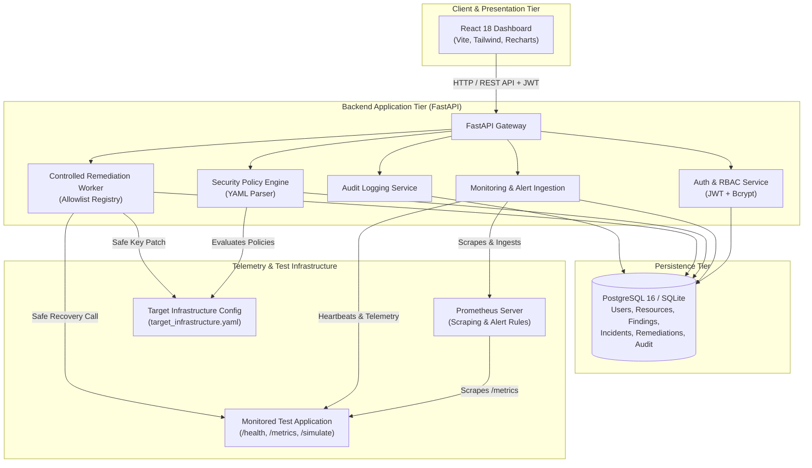

# CloudShield: Architecture, Use Cases & Data Flow Specifications

## 1. System Architecture Diagram



---

## 2. Use Case Diagram

```mermaid
flowchart LR
    Operator["User: Operator"]
    Admin["User: Administrator"]
    SystemWorker["System Worker / Daemon"]

    subgraph CloudShieldPlatform ["CloudShield Platform Boundary"]
        UC1(["UC-1: Authenticate & Refresh Session"])
        UC2(["UC-2: View Live Telemetry & Resources"])
        UC3(["UC-3: Ingest Metric Alerts & Deduplicate"])
        UC4(["UC-4: Trigger Configuration Security Scan"])
        UC5(["UC-5: Acknowledge & Triage Incidents"])
        UC6A(["UC-6a: Submit Remediation Request"])
        UC6B(["UC-6b: Approve & Execute Remediation"])
        UC7(["UC-7: Review Immutable Audit Logs"])
    end

    Operator --> UC1
    Operator --> UC2
    Operator --> UC4
    Operator --> UC5
    Operator --> UC6A

    Admin --> UC1
    Admin --> UC2
    Admin --> UC4
    Admin --> UC5
    Admin --> UC6A
